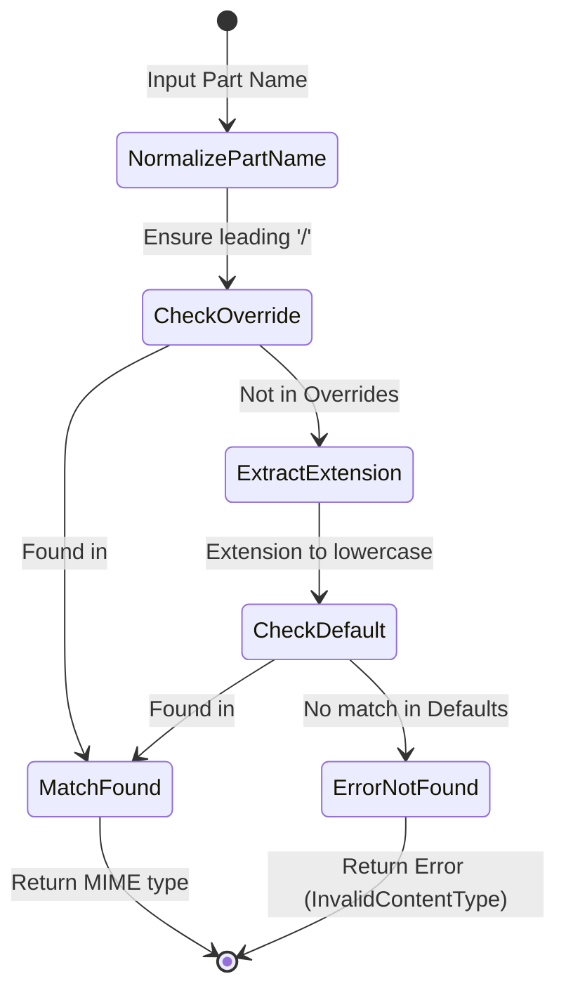

# ECMA-376 Part 2 Open Packaging Conventions (OPC) Specification
**Subphase:** 1.2.1  
**Target:** `crates/ooxml-opc`  
**Standard:** ISO/IEC 29500-2:2021 / ECMA-376 Part 2 (Open Packaging Conventions)

---

## 1. Package Architecture & Required Roots

An ECMA-376 package is an abstract container modeled physically as a ZIP archive containing parts, relationships, and metadata streams.

Every compliant OPC package MUST contain:
1. **`[Content_Types].xml` at the root:**
   - Declares the media types of all parts in the package.
   - Schema: `http://schemas.openxmlformats.org/package/2006/content-types`
2. **`_rels/.rels` at the root:**
   - Identifies package-level entry points and relationships (e.g. pointer to primary document part).
   - Schema: `http://schemas.openxmlformats.org/package/2006/relationships`

---

## 2. Content Types Resolution State Machine

### Parsing Rules
- **`<Default>` element:** Maps file extension (e.g., `xml`, `rels`, `png`) to a content type. Extensions are case-insensitive.
- **`<Override>` element:** Explicitly overrides content type for a specific part (e.g., `/word/document.xml`). Part names must start with `/`.

---

## 3. Hierarchical Relationship Resolution State Machine

Relationships establish directed links between parts, or from the package root to parts, or to external resources.

### Relationship Part Naming Convention
For any source part `A/B/C.xml`, its relationships part is located at `A/B/_rels/C.xml.rels`. For the package root, the relationship part is `_rels/.rels`.

### Target Resolution Algorithm
Given a relationship `(Id, Type, Target, TargetMode)` associated with source part `S`:
1. If `TargetMode == External`: The target is an external URI (e.g. `https://`, `mailto:`); return verbatim without path resolution.
2. If `TargetMode == Internal`:
   - If `Target` starts with `/`: The target is an absolute package path; strip leading slash and normalize.
   - If `Target` does not start with `/`:
     - Determine the base directory of source part `S`: `base_dir = dirname(S)`.
     - Concatenate: `combined = base_dir + "/" + Target`.
     - Normalize path segments: remove `.` and resolve `..` parent references.
     - Return normalized package path.

---

## 4. Performance & Memory SLA Invariants

1. **Lazy ZIP Entry Reader:**
   - Central directory is indexed into a hash map in `< 1.0 ms` upon opening.
   - Does NOT decompress document bodies, image streams, or large worksheet grids upfront.
2. **Streaming Pull Parsing:**
   - `quick-xml` event-driven streaming parser reads `[Content_Types].xml` and `.rels` files directly without building intermediate heavy DOM trees.
   - Relationship resolution completes in `< 15 ms` even for 100MB+ packages.
